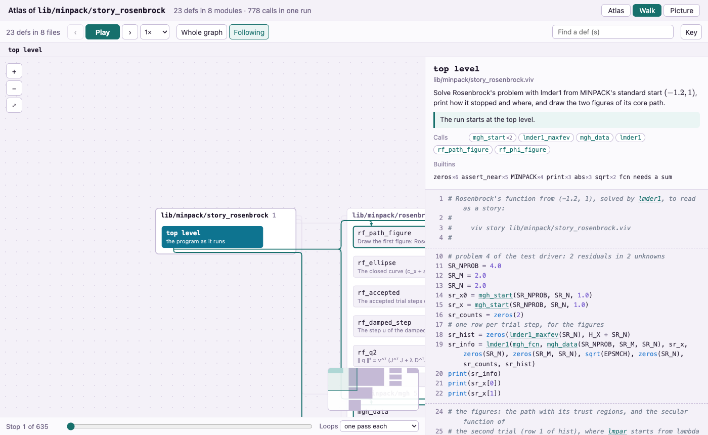

<p align="center">
  <picture>
    <source media="(prefers-color-scheme: dark)" srcset="www/public/brand/viv/viv-mark-dark.svg">
    
  </picture>
</p>

<h1 align="center">Viv</h1>

<p align="center">
  A small language for numerical programs that runs in an interpreter, as C99 and as WebAssembly.
</p>

<p align="center">
  
  <a href="LICENSING.md"></a>
</p>

Viv is a small language for numerical programs, and it uses NumPy's names for arrays.
The compiler is written in Rust and also ships as a WebAssembly module, so
the whole language, compiler included, runs in a browser page. Every program
runs in three engines (the interpreter, compiled C and compiled wasm) that
must print the same bytes; a program whose engines disagree has found a bug
in one of them. From Python, the package vipyr compiles a `.viv` file on
first use and calls its defs as Python functions.



*`viv atlas lib/minpack/story_rosenbrock.viv` writes one HTML file: the
program's defs by module, the calls between them, and a walk through one run
line by line. It opens offline.*

## Quickstart

You need Rust 1.77 or newer, a C compiler (clang or gcc), and for the Python
part Python 3.9 or newer with NumPy. macOS and Linux are supported.

```sh
git clone https://github.com/AdamZettel/viv
cd viv
sh quickstart.sh
```

`quickstart.sh` checks the prerequisites and says how to install any that
are missing (it installs nothing itself), then runs the steps below. Run it
again at any time; it writes only under `target/` and vipyr's cache. The
same steps by hand:

**Build the compiler.** The first build downloads crates and takes a few
minutes.

```sh
cargo build --release -p viv          # the compiler: target/release/viv
```

**Run a first program.** [`examples/hello.viv`](examples/hello.viv) is the
program on the site's home page, written as a def: Newton's method for a
square root, with an exact derivative from `deriv` and a `test` block that
checks the answer.

```viv
NEWTON_STEPS = 6

def newton_sqrt(a: Num) -> Num {
    x = 1.0
    for i to NEWTON_STEPS {
        x = x - (x * x - a) / deriv(fn(t) -> t * t - a, x)
    }
    return x
}

x = newton_sqrt(2.0)
# sixteen digits: the default six would hide how close it is
show fmt(x, ".16g")

test "x squared is 2, within one unit in the last place of 2" {
    assert_near(x * x, 2.0, 4.5e-16)
}
```

```text
$ target/release/viv run -q examples/hello.viv
x: 1.414213562373095
PASS x squared is 2, within one unit in the last place of 2
```

A failed `test` prints what it expected and what it got, and the process
exits nonzero, so a build or CI job can gate on it. (`-q` leaves out the
call-graph records the browser uses.)

**Compile it to C.** The C links only libm and prints the same bytes.

```text
$ target/release/viv examples/hello.viv -o hello.c
wrote hello.c (35 IR nodes, 70 debug entries)
$ cc -O2 hello.c -lm -o hello && ./hello
x: 1.414213562373095
PASS x squared is 2, within one unit in the last place of 2
```

**Write an atlas.** The picture above is this file, open on its Walk tab.

```text
$ target/release/viv atlas lib/minpack/story_rosenbrock.viv -o rosenbrock.atlas.html
viv atlas: running lib/minpack/story_rosenbrock.viv once for its call counts (--no-run skips the run)
viv atlas: recording the walk, the run line by line (--no-walk skips it)
wrote rosenbrock.atlas.html (2053 KB): open it in a browser; it needs no network
```

`--text` prints the same map in the terminal, and `--json` gives it to a
tool.

**Call it from Python.** vipyr is in `python/vipyr`; from a checkout it uses
the compiler you just built (or `$VIV`, or a `viv` on your PATH).
`vp.load` compiles the file to a C library on first use and caches it under
`__pycache__/vipyr/` beside the source.

```text
$ PYTHONPATH=python python3
>>> import math
>>> import vipyr as vp
>>> hello = vp.load("examples/hello.viv")
>>> print(hello.newton_sqrt(2.0), math.sqrt(2.0))
1.414213562373095 1.4142135623730951
>>> print(hello.newton_sqrt(3.0), math.sqrt(3.0))
1.7320508075688774 1.7320508075688772
```

Six Newton steps from 1.0 land within one unit in the last place of the
library square root.

**Next.** `target/release/viv --help` lists the commands, and
`cargo install --path lang/viv` puts `viv` on your PATH.
[docs/tutorial.md](docs/tutorial.md) is a ten-minute tour from the command
line. The site in `www/` has a workbench, an editor with the compiler
running in the page, and a tour of the language in runnable cells;
[The site](#the-site) says how to build it.

## What is in the box

### Three engines

| engine | command | why it is there |
|---|---|---|
| interpreter | `viv run f.viv` | quick debugging; the same interpreter runs in the browser |
| C99 | `viv f.viv -o f.c`, then `cc` | portability and performance; the C needs only libm |
| WebAssembly | `viv f.viv -o f.wasm` | instant calculations in the browser, with no C step |

By default every engine is exact: the same operations in the same order, no
fused multiply-add, and Viv's own libm (fdlibm, as musl carries it) in all
three. `tools/three-engines.sh <dir>` runs a directory of programs through
all three and fails on any difference. Fast mode (`viv run --fast`,
`viv build --fast`) uses the platform's libm, fused multiply-add, BLAS and
LAPACK; its output is not byte-identical, so `viv check --fast` compares it
number by number within a stated tolerance.

### The code atlas

`viv atlas <file.viv>` maps a program: every def the top level reaches, by
module, the calls between them with one run's counts, and a walk through
that run line by line. Each def carries its intent, its named steps and its
loops. The page is a single HTML file with its viewer inside, so it can be
mailed or opened offline. The site's `/atlas` page has atlases of the vipyr
functions.

### Contracts

A `contract` names a problem, lists the defs that solve it, and says what
two methods must agree on. A call runs the default method;
`using every method` runs them all and stops at the first disagreement. The
compiler checks each method's parameters and results against the contract.
`integrate` and `find_root` in `lang/viv/std/contracts.viv` are contracts
over three methods each. `viv features contract-declarations` shows the
syntax with a runnable example.

### vipyr, Viv from Python

vipyr (`python/vipyr`, version 0.0.1, not on PyPI yet) does two things. It
turns your own `.viv` files into Python modules (`vp.load`, or an import hook
with `import vipyr.auto`), and it calls Viv's scientific programs with
keyword arguments: `vp.scf.run`, `vp.dft.pw`, `vp.nuclear.shell_model`,
`vp.control.lqr`, `vp.optimize.curve_fit` and more, each returning its
results with the program's tests and a `check()` method.
[python/vipyr/README.md](python/vipyr/README.md) is the reference, and says
how to install vipyr from the checkout.

### Ported scientific codes, checked against references

As a test of the language, agents ported a set of scientific codes to Viv
and checked each against a reference. Some of them:

| program | checked against | where the numbers are |
|---|---|---|
| Hartree-Fock, `lib/hf` | PySCF 2.5.0: energies within 1.3e-11 hartree on eleven cases, water in STO-3G up to eight waters in 6-31G\* | [study/ports/pyscf/results/RESULTS.md](study/ports/pyscf/results/RESULTS.md) |
| Levenberg-Marquardt, `lib/minpack` | a gfortran build of MINPACK's Fortran, every trial step to the last bit; NIST's certified values for the Thurber fit | [lib/minpack/README.md](lib/minpack/README.md) |
| AC and DC power flow, `lib/power` | MATPOWER's own solution of case9, and a SciPy power flow on every case | [lib/power/COMPARISON.md](lib/power/COMPARISON.md) |
| exchange-correlation functionals, `xc/` | Libxc 6.1.0, from whose Maple scripts they are generated | [xc/README.md](xc/README.md) |
| nuclear shell model, `lib/nuclear/shell` | BIGSTICK: the five lowest states of neon-20 to 1e-5 MeV | [show/sd_shell.viv](show/sd_shell.viv) |
| Skyrme Hartree-Fock, `lib/skyrme` | skyrme_rpa (Colò et al. 2013): oxygen-16 at 8.0250 MeV per nucleon against its 8.0261 | [lib/skyrme/COMPARISON.md](lib/skyrme/COMPARISON.md) |
| radial atom solver, `ports/dftatom` | dftatom's Fortran and NIST's atomic reference data | [ports/dftatom/COMPARISON.md](ports/dftatom/COMPARISON.md) |
| LQR gains, `lib/are.viv` | SciPy's `solve_continuous_are`, to eight digits | [show/cartpole_lqr.viv](show/cartpole_lqr.viv) |

[claims/](claims/) holds claims, each a bounded statement and the program
that checks it; the site's `/claims` page lists them with their status.
`node tools/inventory.mjs ls --grep <word>` finds assets by the reference
they are checked against.

### Tools for agents

- [AGENTS.md](AGENTS.md) is the working guide for an agent in this
  repository: where things are, how to build and check them, and how to
  write Viv for Python callers. `viv help --agent` prints the compiler's
  own guide for an agent.
- [server/mcp](server/mcp/README.md) is a read-only MCP endpoint, served
  at `/mcp` by the site's Netlify Function. Its tools search the posts,
  examples, library modules and builtins (`search`), return a post
  (`get_post`) and return the language reference (`viv_reference`). To run
  a program, use the site's workbench. After a site build,
  `node server/mcp/fn-test.mjs --serve 8788` serves it at
  `http://127.0.0.1:8788/mcp`, and in Claude Code
  `claude mcp add --transport http viv http://127.0.0.1:8788/mcp` adds it.
  The site's `/agents` page covers other clients.
- The site build writes `llms.txt` and `llms-full.txt`, the reference as
  plain text for a model's context.

### The site

`www/` is the source of viv-lang.org, which is not online yet. It builds
from this checkout with Node 22 or newer:

```sh
sh www/build-wasm.sh       # the browser compiler, www/public/viv/viv.wasm
cd www
npm install
npm run build              # the site, in www/dist
npm run preview            # serves www/dist at http://localhost:4325, with netlify.toml's redirects and headers
```

The built site has the workbench (`/workbench`), the language tour
(`/tour`), the docs (`/docs`), the language reference (`/reference`), vipyr's
functions (`/vipyr`), the atlases (`/atlas`), the claims (`/claims`), and
pages for some of the ported codes under `/show`.

## Repository map

| directory | what it holds |
|---|---|
| `lang/viv/` | the compiler: the parser, the interpreter, the C and wasm backends, and the feature catalog behind `viv features` |
| `crates/knotkit/` | the compiler kit Viv is built on |
| `lib/` | libraries written in Viv (Hartree-Fock, MINPACK, linear algebra, power flow, ...) |
| `python/` | vipyr, the Python package, and its tests |
| `scf/`, `dft/`, `xc/`, `plasma/`, `pde/`, `stat/` | application programs and their checks |
| `ports/`, `study/` | ports of published codes and comparisons with Python, with their results |
| `posts/`, `claims/`, `examples/`, `gallery/` | self-checking programs; the posts, claims and gallery entries appear on the site |
| `docs/` | the tutorial |
| `tools/` | the gate, `three-engines.sh`, py2viv and other harnesses |
| `www/` | the site, viv-lang.org, built from this repository |
| `server/mcp/` | the MCP endpoint |

[AGENTS.md](AGENTS.md) has the full table, and `node tools/inventory.mjs`
writes INVENTORY.md, a list of every asset.

## Status

Viv is at 0.0.1, a preview. Most of the code was written by AI agents and is
under review. Expect errors in the ports in particular: each one passes its
comparison, and closer inspection is likely to find mistakes. The language
has few users so far. The story on the site's home page tells how the
project got here and what comes next.

The core syntax (defs, loops, comprehensions, records, `Int`, strings, maps,
f-strings, imports, `test` blocks) and three-engine agreement for the gated
programs are stable enough to rely on. The standard library's layout, the
CLI's subcommands and options, the atlas and lens formats, and fast mode's
flags can change. [KNOWN_LIMITATIONS.md](KNOWN_LIMITATIONS.md) lists the open
bugs and gaps, and [CHANGELOG.md](CHANGELOG.md) what 0.0.1 contains.

Platforms: macOS and Linux, with Clang or GCC. On Windows, MinGW-w64 GCC and
Clang should build the compiler's C output, but this is untested; MSVC is
unsupported (it lacks C99 `_Complex`).

## Contributing

[CONTRIBUTING.md](CONTRIBUTING.md) covers building, the checks, the bug
ledger and the style guide. The checks a change must pass are one list,
run through the gate:

```sh
tools/gate.sh quick                      # while you work: build, cargo test, the core three-engine set, the ratchets
tools/gate.sh premerge                   # before you ask for a merge
tools/three-engines.sh examples hello    # one program through all three engines (needs node and sh www/build-wasm.sh)
```

Report a bug, a friction (something that works but is awkward to write) or
a feature request with the templates in
[.github/ISSUE_TEMPLATE](.github/ISSUE_TEMPLATE), and include the smallest
program that shows the problem.

## License

Licensed under either of the [Apache License, Version 2.0](LICENSE-APACHE)
or the [MIT license](LICENSE-MIT), at your option.
[LICENSING.md](LICENSING.md) explains the scheme. Third-party code and data
keep their own licenses: see [THIRD_PARTY.md](THIRD_PARTY.md), and
REUSE.toml for each file's license.

Unless you explicitly state otherwise, any contribution intentionally
submitted for inclusion in the work by you, as defined in the Apache-2.0
license, shall be dual licensed as above, without any additional terms or
conditions.

## Acknowledgments

The ports are checked against the work of others: PySCF (Hartree-Fock),
Libxc (exchange-correlation functionals), MINPACK from Argonne National
Laboratory (Levenberg-Marquardt), MATPOWER (power flow and its test cases),
SciPy (Riccati equations and power flow), BIGSTICK (the shell model),
dftatom (radial atoms), skyrme_rpa (Skyrme Hartree-Fock), mpmath (the
Landau root), NIST's certified regression data and atomic reference data,
and the Bari IVP test set (stiff ODEs). The Gaussian basis sets come from the
Basis Set Exchange. Viv's libm is the `libm` crate's port of musl's libm,
from FreeBSD msun and Sun's fdlibm. This product includes software developed
by the University of Chicago, as Operator of Argonne National Laboratory
(MINPACK, in `lib/minpack/`).
